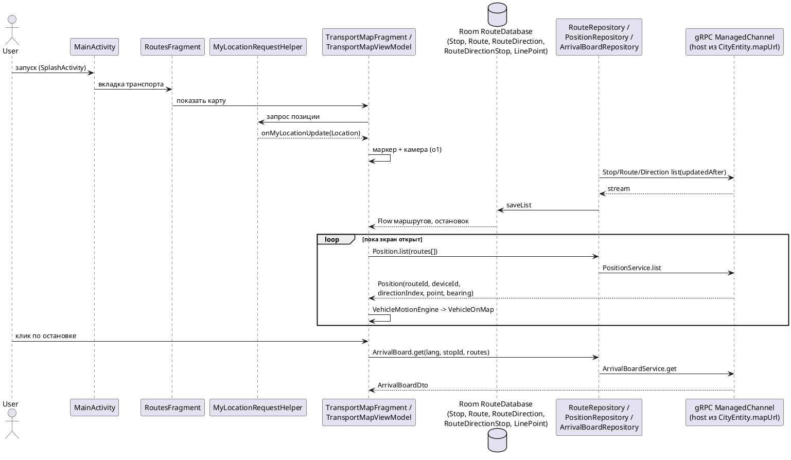
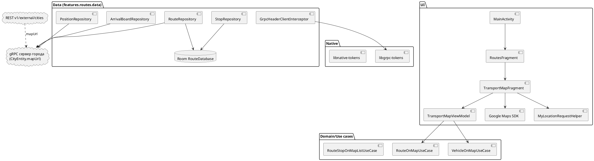

# ONAY! (kz.onay) — отчёт по реверс-инжинирингу

Дата: 2026-11-21. Метод: только статический анализ (jadx 1.5.6, apktool 3.0.3, aapt2, apksigner) копий APK.
Приложение не запускалось, запросы к серверу не отправлялись, токены и ключи не извлекались.
Декомпилированный код не является исходниками: jadx сообщил о 1404 методах с ошибками декомпиляции.
Утверждения помечены: **[код]** — подтверждено кодом, **[вывод]** — логический вывод, **[не подтверждено]** — требует проверки.

## 1. Техническая архитектура

### 1.1 Артефакт
- Файл: `ONAY-Public-transport_3.6.5_apkcube.apks` (bundle из 9 APK: base + arm64_v8a + 7 плотностей экрана).
- SHA-256 `.apks`: `c11640d8bba4530db184fd268af3418dbc4122aeb191c7b072be2240cc025cb6`
- SHA-256 `base.apk`: `840656052ddce7e533f7effb0bbf40d70027e479d2fa02596c9f86f172086838`
- SHA-256 split-ов:
  - arm64_v8a `2e0faefdd2ba914457a37a7ad3c44ad869d50afde95e378840fa86b7ba939c27`
  - hdpi `8f31caeb66742a91fc50fd1c8b83a29c4f24d880344abb6fe3252973b83825ad`
  - ldpi `8002554159aebe5725692540aa3ec208e0ddc19562ab4c694ab88e76469028a2`
  - mdpi `66b5fc3a92389f2feda4eba7bc8287684cb1e5ab700040a2a526538907a648b8`
  - tvdpi `0771d41a48e43dab2a722f3a4259078374b30f1dd332c39180edc6e21133e39a`
  - xhdpi `2ec70f2fecb40f16d2a80d072a7d091344c207c519f25c5bae0eb32bcebf9edb`
  - xxhdpi `3b8c7daf4471913e9e505c5c2cf08b4da119327949367efbbedd69b6d73a4dd8`
  - xxxhdpi `cb64cc43cdc279948a4d11c0f9dd751dddccc2d9212dc249f36612b5920c6f25`
- Package `kz.onay`, versionName 3.6.5, versionCode 23310, minSdk 24, targetSdk/compileSdk 36. **[код]**
- Подпись base.apk: схемы v2 и v3 (v1 нет). Отпечаток сертификата в этом проходе не снимался. **[код]**
- Копии: `work/orig/` (read-only), распаковка `work/apks/`, jadx `work/jadx_out/`, манифест `work/apktool_manifest/`. Оригинал не менялся.

### 1.2 Технологии
- Основное приложение: нативный Android (Java/Kotlin), 11 dex-файлов, Dagger, Room, RxJava + Kotlin coroutines/Flow, Google Maps SDK, gRPC (blocking stubs). **[код]**
- Пакет `kz.onay` не обфусцирован (читаемые имена); остальные библиотеки прошли R8 (`a`, `a0`, `v`…). **[код]**
- React Native (Hermes, `assets/index.android.bundle`, 4.4 MB): по строкам содержит только купонный SDK Kwaaka (`com.kwaakatemplate.CouponsActivity`), к транспорту отношения не имеет. Hermes-байткод не декомпилировался. **[код/строки]**
- Native-библиотеки (arm64): `libgrpc-tokens`, `libnative-tokens`, `libecom-grpc-secret-keys`, `libdda7`, `liboz_native`, `libozdat`, `libsentry`, TFLite и др. Роль `libdda7`, `liboz_native`, `libozdat` не выяснена. **[не подтверждено]**
- Партнёрские модули: `kz.halyk.partner.monolith` (оплата: fingerprint подписи, root-детектор, SafetyNet).

### 1.3 Права
`INTERNET`, `ACCESS_FINE_LOCATION`, `ACCESS_COARSE_LOCATION` (и др.). **[код]**

## 2. Найденные классы и методы

Корень: `work/jadx_out/sources/kz/onay/`.

| Компонент | Класс / метод | Доказательство |
|---|---|---|
| Launcher | `ui.splash.SplashActivity` | intent-filter MAIN/LAUNCHER в манифесте; `startActivity` в `MainActivity` / `AuthActivity` / `IntroActivity` (строки ~157–172) |
| Главный экран | `ui.main.MainActivity` | вкладка транспорта: `return RoutesFragment.newInstance()` (~стр. 843) |
| Экран транспорта | `ui.routes2.frontscreen.RoutesFragment` | `FragmentStatePagerAdapter` над списком фрагментов |
| Карта | `ui.routes2.transportmap.TransportMapFragment` (1842 стр.), `TransportMnemoMapFragment`, `TransportSchemaFragment` | `mGoogleMap`, `CameraUpdateFactory`, `Marker` |
| ViewModel карты | `ui.routes2.transportmap.TransportMapViewModel` (1322 стр.) | `myLocation`, `loadArrivalBoard(Marker, Long, List<Long>)` |
| GPS | `ui.routes2.shared.MyLocationRequestHelper` | `FusedLocationProviderClient`, `LocationCallback`, `LocationSettingsRequest`; слушатель `onMyLocationUpdate` |
| Реакция на GPS | `TransportMapFragment.o1(Location)` | ставит маркер, на первом fix двигает камеру |
| Список маршрутов | `ui.routes2.interactor.RoutesDataInteractorImpl` | `routeRepository.getLocalListFlow()` из Room |
| Репозитории | `features.routes.data.repositories.*` | `RouteRepository`, `StopRepository`, `PositionRepository`, `VehicleRepository`, `TripRepository`, `ArrivalBoardRepository`, `GeoCodingRepository`, `ConfigurationRepository` |
| Источники gRPC | `features.routes.data.datasources.*` | `StopDataSource.getList(updatedAfter)` |
| gRPC-модуль | `features.routes.data.RouteGrpcModule.provideManagedChannel` | `ManagedChannelBuilder.forAddress(host.trim(), port)`, keepAlive 30 с, max inbound 10 MB |
| Заголовки | `features.routes.data.interceptors.GrpcHeaderClientInterceptor` | ключи: auth token, device id, factory, lang, model, os, os version, app version |
| Сборка конфигурации | `di.RouteComponentHolder.build()` | `grpcConfiguration.host = cityPrefs.getSelectedCityMapUrl()` |
| Хост по городу | `city.data.remote.CityApiClient` (`GET v1/external/cities`), `CityEntity.mapUrl`, `CityPrefs` | |
| Автобусы на карте | `ui.routes2.models.VehicleOnMap`, `usecases.VehicleOnMapUseCase`, `renderers.VehicleMotionEngine` | |
| Геометрия на карте | `models.RouteOnMap`, `RouteDirectionOnMap`, `RouteSegment`, `usecases.RouteOnMapUseCase` | `linePointList`, `visibleSegments` |
| Токены | `features.routes.security.GrpcTokens`, `security.NativeTokens` | `System.loadLibrary`, `native` методы |

Поиск готовой логики «ближайшая остановка» (`nearest/nearby/closest`) в `kz.onay` результата по транспорту не дал: найдены только модуль оплаты по Bluetooth и ресурсы. **[код]**

## 3. Схема движения данных (GPS → автобусы)



Архитектура модулей:



## 4. Сетевые API и модели данных

### 4.1 REST
- `GET v1/external/cities` (`CityApiClient.getCityList`) — список городов с `mapUrl`, координатами. **[код]**
- `GET v2/external/card/points` с `X-Short-Token` и `cityId` — точки обслуживания (к транспорту не относится). **[код]**

### 4.2 gRPC (хост = `mapUrl` выбранного города, порт 443)
Сервисы: Route, Stop, Vehicle, Position, Trip, ArrivalBoard, GeoCoding, Configuration. **[код]**

| Сервис / метод | Запрос | Ответ (поля) |
|---|---|---|
| Stop.list | `updatedAfter` (Timestamp) | stream `Stop{id=1, name=2 (map языков), point=3 (latitude, longitude), routes=4 (repeated)}` |
| Stop.get | `stopId` | `Stop` |
| Stop.listDeleted | `deletedAfter` | stream `AuditRecord{id, timestamp}` |
| Position.list | `locatedAfter=1`, `routes=2` | stream `Position{deviceId=1, routeId=2, directionIndex=3, actualPoint=4, routePoint=5, bearing, lineIndex, offsetDistance, timestamp}` |
| ArrivalBoard.get | `lang=1`, `stopId=2`, `routes=3`, `orderBy=4` | `title`, список vehicles (`routeId`, `timestamp`, `data`) |

Заголовки каждого вызова: auth-token (из native), device id, версия приложения, язык, производитель и модель, версия ОС. **[код]**

### 4.3 Локальная модель (Room, `features.routes.data.database.entities`)
- `Stop(id, lat, lng, …)`; `Route(id, typeId, mainRouteId, …)`.
- `RouteDirection(routeId, directionIndex, distance, durationSeconds, listIndex)`.
- `RouteDirectionStop(routeId, stopId, directionIndex, lineIndex, listIndex, offsetDistance)` — порядок остановок направления.
- `RouteDirectionLinePoint(routeId, directionIndex, lineIndex, latitude, longitude, distancePrev, distanceNext)` — геометрия маршрута.
- `Vehicle(id, deviceId, routeId, boardNumber, …)`, `Position(routeId, deviceId, directionIndex, actual/route lat/lng, bearing, …)`.
Синхронизация инкрементальная (`updatedAfter`, списки удалённых). **[код]**

**Поправка (проход 2, по коду):**
- Room-сущность `Stop` хранит только `id`, `lat`, `lng`, `isDeleted`, `createdAt`, `authority`. Поле `routes[]` из proto-ответа `StopService` (`StopDto.routes`) в Room **не сохраняется**; названия остановок лежат в таблице `Localization`. Связь «остановка → маршруты» локально можно получить только через `RouteDirectionStop` (`routeId`, `stopId`, `directionIndex`). В `RouteDirectionStopDao` нет запроса только по `stopId` (есть по `routeId`+`stopId`), его пришлось бы добавить или читать таблицу целиком.
- `RouteDirectionStop` и `RouteDirectionLinePoint` заполняются при сохранении полного `Route` (`RouteRepository.E(RouteDto)`). Полный маршрут приходит из `RouteService.get(routeId)`; `RouteRepository.getItem` догружает его лениво, если в базе меньше 3 строк `RouteDirectionStop` для маршрута. Основной путь обновления списка идёт через `listSimpleRoutes` (только имена и простые данные). Следствие **[вывод, не проверено]**: у маршрутов, которые пользователь ни разу не открывал, остановок и геометрии в Room может не быть. `RouteService.list(updatedAfter)` тоже возвращает полный `Route` (тот же маппер), но использует ли его приложение при обычной синхронизации, не установлено.
- Для функции «все маршруты на остановке» надёжный источник: `StopService.get/list` (поле `routes`) для самой остановки плюс `RouteService.get` для геометрии каждого маршрута.

### 4.4 Не подтверждено
- `directionIndex == 2`: **частично выяснено.** В `RouteStopOnMapListUseCase.getList(positions, num, lang)` условие `num == 2 || position.directionIndex.equals(num)` означает, что `2` в параметре фильтра («выбранное направление» из `mapState.directionIndex`) работает как «все направления». Это значение фильтра UI, а не данные сервера. Где именно UI выставляет 2, не прослежено **[не подтверждено]**. Реальные `directionIndex` из `Position`/`RouteDirection`: значения сервера не проверялись.
- Содержимое `Vehicles.data` в табло прибытия.
- Содержит ли `Stop.routes[]` (поле proto, `StopDto.routes`, в Room не сохраняется) идентификаторы маршрутов или направлений; различается ли «сторона дороги» чем-то кроме `directionIndex` и привязки остановки к направлению.
- `assets/ways.json` (2.8 MB; routes `type` bus/troll, `forward/backwardStops` с id, name, long, lat): ссылок на него в коде не найдено, использование не подтверждено; как источник данных использовать нельзя.
- Что в ответе сервера при нулевом числе маршрутов на остановке.

## 5. Возможности изменения UI
- Точка подмены экрана: `MainActivity` (~стр. 843), одна строка `RoutesFragment.newInstance()`.
- Готовый материал для UI: `RouteNumberAdapter`, `RouteNumberListAdapterNew*` (кнопки с номерами маршрутов), `RouteOnMapUseCase` + `RouteDirectionOnMap.visibleSegments` (отрисовка геометрии), `VehicleOnMapUseCase`, `VehicleMotionEngine`, `StopInfoWindowRecyclerAdapter`, `MyLocationRequestHelper`.
- Маршрутов на остановке: из ответа `StopService` (`routes[]`, не хранится в Room) и/или `RouteDirectionStop` по `stopId` (может быть неполным, см. поправку в §4.3). Направление: `directionIndex` + порядок `listIndex`/`lineIndex`.
- Полупрозрачность невыбранных маршрутов: через `alpha` у `Polyline`/цвета линий Google Maps (стандартный API карты).
- Ручной выбор остановки: клик по маркеру уже есть (`loadArrivalBoard`), поиск — `travelsearch`.

## 6. Технические препятствия
0. **Результат пробной переподписи (2026-11-21, Poco X5 5G, Android 14, arm64).** Все 9 APK оригинальной сборки 3.6.5 переподписаны тестовым ключом без изменения содержимого (`apksigner`, без пересборки apktool), поставлены `adb install-multiple` после удаления оригинала из Google Play. Наблюдалось (со слов пользователя и по logcat): приложение стартует без падения, проходит вход, открывается `MainActivity`; в logcat нет `Authorization failure` Google Maps и ошибок gRPC; со слов пользователя карта на вкладке транспорта отображается. Не проверено: остановки и автобусы на карте, платежи, Firebase-пуши, Google Sign-In, Yandex Auth, партнёрский модуль Halyk. Вывод: переподпись сама по себе не блокирует запуск, вход и карту. Пересборка через apktool (изменение dex/ресурсов) не проверялась.
0a. **Результат пробной пересборки apktool без изменений (2026-11-21).** `apktool d` декодирует `base.apk` за ~13 с без ошибок; `apktool b` собирает его (~30 с, итоговый размер ~170 МБ против 157 МБ у оригинала), после `zipalign -p 4` и `apksigner` тестовым ключом приложение ставится поверх (`adb install-multiple -r` вместе с 8 переподписанными split-ами) и стартует без падения (процесс жив ~18 с, `logcat -b crash` пуст; экран телефона в этот момент был погашен, поэтому вход и карту на пересобранной версии визуально не проверяли). Ловушки, которые пришлось пройти:
    - Лаунчер `/usr/bin/apktool` на этой системе задаёт `-Xmx256M`; `JAVA_OPTS` игнорируется. Без `-JXmx10g` сборка падает с `OutOfMemoryError` в `ApkBuilder.buildResources`.
    - После упавшей сборки в `build/` остаются частично скомпилированные ресурсы. Следующая сборка собрала APK всего с 450 файлами ресурсов вместо 2563, и приложение упало при старте: `Failed to parse XML configuration from network_security_config` (`FileNotFoundException: res/xml/network_security_config.xml`). Лечится удалением (или переименованием) `build/` и сборкой с `-f`.
    - Нужны `zipalign` и подпись всех split-ов одним ключом.
    Ручная проверка пользователем на пересобранной (apktool) и переподписанной сборке на Poco X5 5G / Android 14: вход сохранился, вкладка транспорта открывается, карта отображается, остановки и автобусы видны, ошибок нет; в logcat падений, ANR и ошибок авторизации Google Maps нет.
    Вывод: plain-rebuild работает, если соблюдать эти условия. Работа с изменёнными smali/ресурсами не проверялась.
0b. **Находка: proto-файлы внутри APK.** В `unknown/` декодированного дерева лежат определения сервисов (`stopService.proto`, `positionService.proto`, `routeService.proto`, `arrivalBoardService.proto`, `tripService.proto`, `vehicleService.proto`, `geoCodingService.proto`, `configurationService.proto`, `PartnerLayer*.proto`). Из них подтверждено: `Stop.Routes` = «список идентификаторов маршрутов, связанных с остановкой» (id маршрутов, не направлений); `Stop.Name` = `map<string,string>` по языкам; `Position.DirectionIndex` = `int32`, `Point.LineIndex` = `Int32Value`; `ArrivalBoard.VehicleToStopData.Data` = `string` без описания формата; `ArrivalBoard.OrderField` = `TimeOrDistance | RouteName`.
1. **Подпись.** Пересборка требует нового ключа подписи. Возможные последствия **[вывод, не проверено]**: ключ Google Maps (если ограничен по SHA-1/пакету), Firebase, Google Sign-In, Yandex Auth, fingerprint в Halyk. Все 9 split-ов подписываются одним ключом, установка `adb install-multiple`.
2. **Native-токены.** `libgrpc-tokens`/`libnative-tokens` выдают токены; привязка к подписи/окружению **не проверена**. Обходить защиту не планируется; собственный код должен ходить в сеть только через существующие классы приложения.
3. **Нет исходников.** Изменения возможны на уровне smali; новый код нужно собирать отдельно и встраивать как dex. Обфусцированные библиотеки Google Maps и др. менять не нужно.
4. **Проверки целостности** есть в партнёрском модуле оплаты (Halyk): не трогать.
5. **Версии.** Любое обновление приложения ломает патч; нужен перепатч.
6. **Правовая сторона.** Условия использования приложения и модификация чужого APK — вне рамок этого отчёта; решение за владельцем задачи.
7. **Hermes bundle** не разбирался, к транспорту не относится.

## 7. Рекомендуемый подход

**B-lite**: новый экран «Рядом» с минимальным вмешательством в существующий код.

| | A: правка существующего экрана | B: новый экран |
|---|---|---|
| Объём | smali-правки в `TransportMapFragment` (1842 строки) и `TransportMapViewModel` (1322) | новый фрагмент и ViewModel |
| Риск регрессий | высокий | средний (старый экран остаётся) |
| Тестируемость | низкая (всё в View/Maps) | выше (логика в чистых функциях) |
| Шанс пересборки | ниже | выше |

Состав:
- Новая логика на Kotlin (чистая): `NearestStopFinder`, `RoutesAtStopSelector`, `RouteHighlightState` — без Android-зависимостей, для юнит-тестов.
- Новый фрагмент (`NearbyStopFragment`) на Google Maps SDK, получающий `RouteRepository`/`StopRepository`/`PositionRepository` из существующего графа Dagger.
- Один хук в `MainActivity` (вкладка транспорта → новый фрагмент, прежний экран доступен кнопкой).
- Код компилируется в dex (d8) и добавляется как `classesN.dex`; ресурсы — через apktool; подпись `apksigner` своим ключом.

## 8. Поэтапный план реализации
0. **Проверка предпосылок (до кода):** собрать/переподписать неизменённый APK и убедиться, что карта, GPS, транспортные данные работают на эмуляторе с Google Play; проверить 4 пункта из §4.4 (можно по собственному аккаунту и разрешённым данным).
1. Чистая логика + юнит-тесты (JVM).
2. Новый фрагмент с картой (заглушки данных).
3. Подключение репозиториев приложения; выбор ближайшей остановки по GPS.
4. Кнопки маршрутов, геометрия всех маршрутов остановки, выделение выбранного (alpha невыбранных).
5. Направление и сторона дороги (по `directionIndex`/`RouteDirectionStop`).
6. Ручной выбор остановки, обработка отсутствия GPS и отказа в разрешении.
7. Хук в `MainActivity`, сборка dex, подпись, `adb install-multiple`.
8. Интеграционные тесты, затем реальное устройство.

Структура будущего проекта (не создана):
```
onay-nearby/
  logic/   (чистый Kotlin: finder, selector, highlight state, модели)
  ui/      (NearbyStopFragment, адаптер кнопок маршрутов)
  patch/   (smali-хук MainActivity, список изменений ресурсов)
  build/   (скрипты: d8, apktool, apksigner, adb install-multiple)
  tests/   (unit, instrumentation)
```

## 9. План автоматизированных тестов

### Юнит-тесты (JVM, без Android)
- **Ближайшая остановка:** выбор из набора по расстоянию (haversine), равные расстояния, пустой список, остановки на границе меридиана, ограничение радиуса.
- **Отбор маршрутов:** только bus/troll, исключение удалённых, дубли, остановка без маршрутов.
- **Направления:** две остановки с одним названием по разные стороны дороги дают разные `directionIndex`; остановка, принадлежащая только одному направлению; значение `directionIndex == 2` (после выяснения).
- **Нет GPS:** `null`-локация, отказ разрешения, выключенная геолокация, устаревший fix: экран не падает, предлагает ручной выбор.
- **Выбор и подсветка:** выбранный маршрут alpha 1.0, остальные пониженный; повторное нажатие снимает выбор; смена остановки сбрасывает выбор.

### Интеграционные (эмулятор с Google Play)
- Подмена GPS через `adb emu geo fix` / mock location; проверка, что открывается ожидаемая остановка и кнопки маршрутов.
- Нет сети; сервер отвечает ошибкой; пустая база Room (первый запуск); смена города.
- Поворот экрана, фон/возврат, потеря и возврат разрешения.
- Установка split-набора, обновление поверх, запуск холодный и тёплый.

### Реальное устройство
- Реальные GPS-фиксы на улице, дрейф GPS; соответствие кнопок маршрутам, реально проходящим через остановку; направление и сторона дороги; потребление батареи.
- Проверка, что оплата, авторизация, купоны (Kwaaka) и карта в остальных частях приложения по-прежнему работают.

### Ограничения этого отчёта
Динамический анализ не выполнялся; значения ключей, токенов и заголовков не извлекались; `directionIndex == 2`, роль `libdda7`/`liboz_native`/`libozdat`, поведение при переподписи и использование `ways.json` остаются неподтверждёнными.
