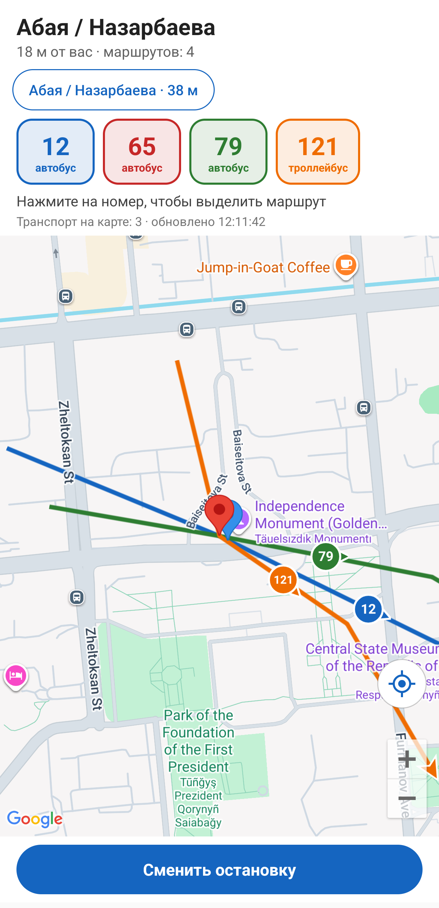

<div align="center">

# onay-free

Неофициальная модификация приложения ONAY! (`kz.onay` 3.6.5):
экран «Рядом» с ближайшей остановкой и транспортом на карте, без рекламы.



</div>

> [!WARNING]
> Проект не связан с разработчиками ONAY! и не одобрен ими. Это правка чужого приложения: сборка подписана тестовым ключом, а не ключом издателя. Используйте на свой риск. Оригинальное приложение из Google Play нужно удалить перед установкой.

## Возможности

- Экран «Рядом» на вкладке **Life**: ближайшая остановка, расстояние до неё, маршруты, проходящие через неё.
- Транспорт на карте в реальном времени, выделение маршрута по нажатию на номер.
- Кнопка «Сменить остановку» и кнопка «Моё местоположение».
- Реклама удалена: флаги, загрузчики Yandex Ads, баннерные контейнеры.
- Остальные вкладки (Routes, Cards, Menu) и раздел «Discounts» оригинальные.

Данные берутся из внутренностей приложения: локальная БД Room и gRPC-канал оригинала. Своего сервера и дополнительных запросов нет.

## Требования

- Android 7.0+ (minSdk 24), протестировано на Android 14, arm64.
- Сборка рассчитана на arm64. Для других архитектур нужны другие split-APK.

## Установка

Сборка состоит из набора split-APK, одного файла нет. APK и ключ в репозиторий не входят.

```sh
adb install-multiple work/out/*.apk
```

Нужны `base.apk`, `split_config.arm64_v8a.apk` и dpi-файлы из `work/out/`. Одиночный `base.apk` не запустится.

## Сборка

Нужны исходные split-APK ONAY! 3.6.5 в `work/apks/` и инструменты: `apktool`, `jadx`, `enjarify`, `apksigner`, `zipalign`, `adb`.

```sh
scripts/prepare_classpath.sh      # один раз, около 6 минут
scripts/build_dex.sh
ONAY_KS=work/keys/test.jks ONAY_KS_PASS=<пароль> scripts/build_apk.sh
scripts/install.sh
```

Тестовый ключ создайте сами (`keytool`, alias `test`) и храните вне git. Каталог `work/` в `.gitignore`.

Отладочная Activity с тестовыми данными и подменой координаты собирается только при `ONAY_DEBUG_ACTIVITY=1`. В обычной сборке её нет.

## Структура

| Путь | Что внутри |
|---|---|
| `app/logic/` | чистая логика «Рядом»: расстояния, выбор остановки, фильтры транспорта (без Android) |
| `app/ui/` | фрагмент, источник данных, отладочная Activity |
| `scripts/` | сборка, подпись, установка, мутационная проверка |
| `docs/PATCHES.md` | все правки оригинала и зависимости от внутренностей 3.6.5 |
| `docs/architecture.puml` | диаграммы архитектуры (PlantUML) |

## Тесты

100 JUnit-тестов на логику, 53 мутанта убиты. Подробности в `TEST_RESULTS.md`.

## Документация

- [`ONAY_REVERSE_ENGINEERING.md`](ONAY_REVERSE_ENGINEERING.md): как устроено оригинальное приложение и почему выбран подход с минимальными правками.
- [`IMPLEMENTATION_REPORT.md`](IMPLEMENTATION_REPORT.md): журнал реализации и что проверено на устройстве.
- [`docs/PATCHES.md`](docs/PATCHES.md): список правок оригинала.

## Известные ограничения

- Названия остановок берутся по языку устройства, а не приложения.
- Позиции транспорта: только `actualPoint` с общим временем снимка.
- Не проверено на устройстве: отказ в геолокации, платежи и QR, частичный сбой маршрутов.
- Обновление ONAY! из Play невозможно: подпись другая. Правки привязаны к версии 3.6.5.
