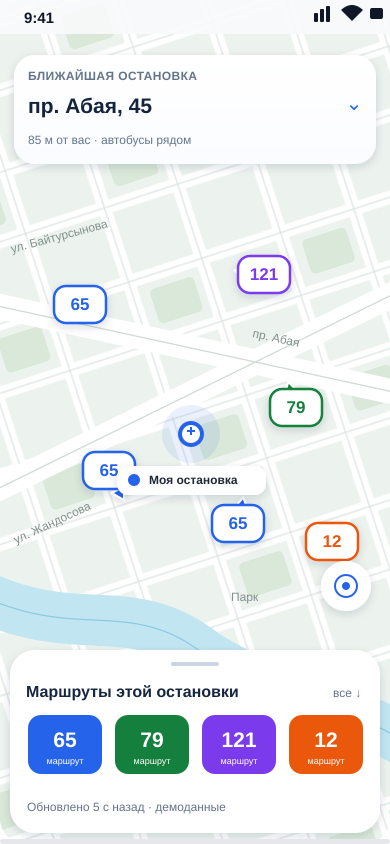
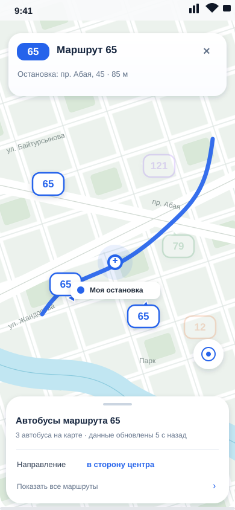

# ONAY Free — stop-first, map-first UI proposal

> Status: **design proposal / interactive prototype**, not a working Android implementation.  
> Tracks [Issue #3](https://github.com/megannnn98/onay-free/issues/3).  
> Open [the prototype](./stop-first-preview.html) in any browser (no network needed).

## Core principle

**The stop decides which vehicles are relevant; the map shows where each one is.**

A user standing at a stop must see within seconds:
- which stop is selected (including which side/direction of the road),
- which bus/trolleybus routes serve that stop,
- where the relevant vehicles are **now**, with readable route numbers and direction,
- how old the location data is.

The app **opens directly to this view**. Logins and payment never interrupt the transport flow. If payment is retained, it is buried under a secondary menu and requires an explicit action.

## Proposed screen

The map is the main background and occupies the whole available display. Two small overlays are used:

- **Top stop selector**: full stop name, distance, change stop; tapping opens a nearby-stop sheet. Show the reverse-side stop as a prominent nearby option if known. Do **not** change to the reverse direction silently.
- **Bottom collapsed route dock**: compact horizontally scrollable chips for all routes serving the selected stop, plus a clear "All" state and a small "updated" indicator. Expand or swipe to show more route details, then collapse back to the map.

### Behavior by state

| State | Map | Overlay |
| --- | --- | --- |
| Launch | nearest stop and **all relevant vehicles**; retain sensible ~300–800m viewport | stop + chips; loading state until positions arrive |
| Route selected | emphasize matching vehicle pins and only the selected polyline near this stop, de-emphasize others | selected chip and optional direction label; tap again / "All" to reset |
| Vehicle tapped | keep visible position, emphasize that marker | compact details; no unsupported speed/ETA |
| Change stop | show clickable nearby stops, clear distinction for opposite direction | picker with list / distance, back/cancel restores previous stop |
| Denied location | preserve map + manual stop selection (or last user choice) | unobtrusive manual picker |
| Network offline | keep cached map if possible; **never imply positions are live** | retry, timestamp and stale state |
| No authorization for routes | show truthful actionable unavailability instead of fake positions | no login wall on map start |

### Visual priorities

1. **Vehicle markers**: legible route number (at least ~14sp on phone), contrasting white or high-contrast background, small arrow clearly separate from label; no false arrow if direction unknown. Avoid placing the number under another marker.
2. **Stop marker**: visually distinct from vehicle markers, including chosen stop vs current location; direction/side-of-road needs explicit label if available.
3. **Polylines**: *not* all bright at once. Draw a route line for the selected route only; keep the rest hidden or very faint. Don't automatically zoom out to include the entire city-wide polyline.
4. **Bottom dock**: default height ~100–150dp; expandable for many routes; map remains visible.
5. **Other functions**: payment, Cards, profile etc. only behind "More" → a further explicit tap, **not** an always-visible nav/QR action. Payment permission/auth may remain exclusively in that flow.

## Code mapping: existing vs required

Existing implementation: 
- \`app/ui/kz/onay/nearby/ui/NearbyStopFragment.java\` builds the screen programmatically.
- \`RoutesAtStopSelector\` finds the routes that actually serve the chosen stop and matching directions.
- \`VehicleFilter\` selects fresh, valid-position vehicles for those routes (currently positions up to 180s old, refresh every 5s).
- \`RouteHighlightState\` tracks route selection; stop picker and nearby alternatives already exist.
- \`scripts/patch_smali.py\` currently mounts "Рядом" under the legacy **Life** tab.

Implementation tasks **for a separate code PR**:
- Move the fragment layout from a vertical stack into a full-height map with overlay panels; account for system insets and dynamic font sizes.
- Replace small colored-disc vehicle markers (currently 44dp bitmap with a 28dp disc / ~11–13sp labels) with readable numbered badges, separate direction indicator and marker clustering/overlap handling.
- Stop rendering all prominent polylines in \`drawStop()\` by default, and cap \`fitCamera(routeId)\` to the stop vicinity and relevant vehicle positions. User camera gestures must not be overridden by every refresh.
- Add explicit opposite-side stop and direction switch when stop/route metadata supports it.
- Start in the transport map; remove original bottom navigation/QR overlap at its **host Activity**, not by hiding it only inside the fragment. Preserve payment functionality only in a deliberately accessed secondary page.
- Keep offline states, denied-location behavior, route selection and account-free startup; audit gRPC transport calls before assuming positions always work anonymously.
- Preserve separation of logic/UI; add unit tests and on-device UI smoke tests.

## Do not invent

The current data model exposes vehicle positions, route ID, direction and timestamp, but does **not** establish a reliable predicted arrival time for each stop. The prototype uses synthetic examples, **not production ETA**. A real "2 min" label belongs in the app only after a validated ETA source and tests exist.

## Acceptance criteria for subsequent implementation

- [ ] At cold launch and resume, the first usable screen is the stop-centered bus map.
- [ ] Selected stop and direction remain clearly visible without occupying the map.
- [ ] Route numbers on vehicle pins readable at common Android densities and font scales.
- [ ] Only routes serving the selected stop/direction are displayed; no irrelevant buses.
- [ ] Selecting a route changes the map **without** zooming to an entire city.
- [ ] The user can change to the opposite-side stop in no more than two taps.
- [ ] No login/payment/navigation clutter in the primary transport flow.
- [ ] Stale/unavailable positions distinguishable from live positions.
- [ ] No regression in location denial, manual selection, network failure, polling on resume, map marker lifecycle.
- [ ] Built APK installed and tested on Android 14 ARM64 before claiming feature shipped.

## Review choices

The proposed layout is **variant 1** of the earlier concepts (floating top stop card + bottom route dock), with variant 3's route-focus behavior. The [HTML prototype](./stop-first-preview.html) demonstrates interaction states; the SVGs are static design samples. Nothing in this PR changes the production Android app.
